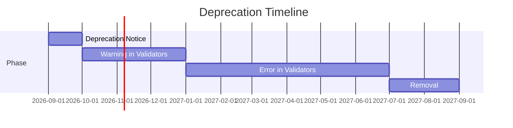

# Deprecation Strategy

When AXAG fields, intents, or patterns need to be removed, a structured deprecation process ensures consumers have time to migrate.

## Deprecation Timeline



| Phase | Duration | Action |
|-------|----------|--------|
| Notice | Day 0 | Deprecation announced in changelog, docs, and release notes |
| Warning | Months 1–3 | Validators emit deprecation warnings; code continues to work |
| Error | Months 4–9 | Validators emit errors; code still works at runtime |
| Removal | Month 12 | Field/feature removed from spec and validators |

## Deprecation Notice Format

```json
{
  "deprecated": {
    "field": "axag-conformance",
    "values": ["A", "AA", "AAA"],
    "since": "1.1.0",
    "removal": "2.0.0",
    "reason": "Conformance levels are named for what they require, not graded like WCAG",
    "migration": "Use basic, intermediate or full; A, AA and AAA are still accepted and mapped to them"
  }
}
```

## Deprecation in Documentation

Deprecated features are marked in docs with:
- ⚠️ **Deprecated** banner at the top of the relevant page
- Strikethrough in reference tables
- Link to migration guide
- Replacement recommendation

## Migration Guides

Every deprecation includes a migration guide with:
1. What is changing and why
2. Before/after code examples
3. Automated migration script (where possible)
4. Timeline for removal

## How to Check for Deprecations

`axag-lint` has no deprecation rule yet. Until it does, deprecations are announced in the release notes with a search you can run:

```bash
# Find annotations that declare themselves deprecated
grep -rn 'axag-deprecated="true"' src/

# Find uses of a value a release has deprecated, e.g. the pre-1.1 action types
grep -rnE 'axag-action-type="(create|mutate)"' src/
```

When a deprecated value is also invalid — as `create` and `mutate` are in 1.1 — `axag-lint` already reports it (AXAG-LINT-004).
