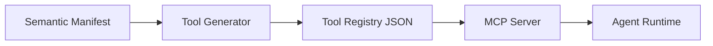

# Tool Registry Generation

The Tool Registry is a collection of all MCP tool definitions generated from the Semantic Manifest.

## Registry Structure
```json title="Tool registry structure"
{
  "schema_version": "1.0.0",
  "generated_at": "2026-03-14T10:00:00.000Z",
  "source_manifest": "axag-manifest.json",
  "tools": [
    { "name": "product_search", "description": "…", "input_schema": {}, "metadata": {} },
    { "name": "cart_add_item", "description": "…", "input_schema": {}, "metadata": {} },
    { "name": "checkout_begin", "description": "…", "input_schema": {}, "metadata": {} }
  ]
}
```

## Generation Pipeline


## Serving the Registry

| How | Produced by |
|-----|-------------|
| `axag-tools.webmcp.json` in your build output, next to `/.well-known/axag-manifest.json` | [`@web-axag/compiler`](/docs/tool-generation/build-time-compilation) |
| `import { tools } from 'virtual:axag/tools'`, registered in the page for as long as their UI is on screen | `@web-axag/compiler` + [`@web-axag/webmcp`](/docs/frameworks/runtime) |
| An MCP server over stdio, offering whatever a browser tab has registered right now | [`@web-axag/bridge`](/docs/frameworks/bridge) |
| `tool-registry.json` written in CI | `axag generate --tools` or `axag generate-tools` |
