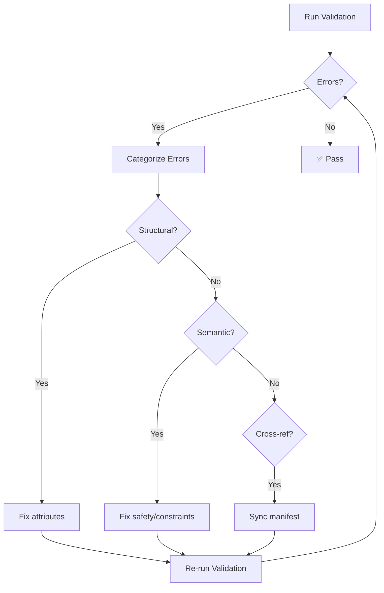

# Remediation Guidance

When AXAG validation produces errors or warnings, this page provides step-by-step guidance to fix common issues and bring your annotations into conformance.

## Remediation Workflow



## Step 1: Fix Structural Errors First

Structural errors prevent the validator from analyzing your annotations further. Fix these first:

1. **Add missing required attributes**: Every annotated element needs `axag-intent`, `axag-entity`, `axag-action-type`
2. **Fix JSON syntax**: Validate JSON strings in parameter attributes with a JSON linter
3. **Correct enum values**: Use only allowed values for `axag-action-type` (`read`, `write`, `delete`, `navigate`) and `axag-risk-level` (`none`, `low`, `medium`, `high`, `critical`)

## Step 2: Resolve Semantic Warnings

Once structural errors are cleared, address semantic issues:

### Risk/Confirmation Matrix
Ensure your risk levels and confirmation requirements align:

| Risk Level | `confirmation_required` | `approval_required` |
|------------|------------------------|---------------------|
| `none` | Not needed | Not needed |
| `low` | Not needed | Not needed |
| `medium` | Recommended | Not needed |
| `high` | **MUST** | Recommended |
| `critical` | **MUST** | **MUST** |

### Idempotency Checklist
For each write/delete operation, determine idempotency:
- **Idempotent** if calling it twice with the same parameters produces the same result (e.g., set status, update fields, soft delete)
- **Not idempotent** if calling it twice creates duplicate effects (e.g., create record, add to cart, send notification)

### Scope Checklist
For operations that access data, declare the scope:
- `public` — No authentication required
- `user` — Scoped to the authenticated user
- `tenant` — Scoped to the user's organization
- `global` — Affects all tenants (rare, admin-only)

## Step 3: Synchronize Manifest

After fixing annotations, ensure the Semantic Manifest is in sync:

```bash title="Regenerate manifest after fixes"
# Regenerate manifest from annotations
npx axag generate src --manifest axag-manifest.json

# Or manually add missing intents to existing manifest
# Edit axag-manifest.json and add the missing action definitions
```

## Step 4: Let the Tools Do the Mechanical Part

`axag-lint` doesn't rewrite files — each finding needs a decision about risk or scope that only you can make. Two commands do help with the mechanical work:

```bash
# Suggest annotations for unannotated elements and review them interactively
npx axag scan ./src

# Write the ones you accepted
npx axag apply --dry-run
npx axag apply

# Rewrite annotations into one consistent form (macro or longhand)
npx axag fmt src --to macro
```

Suggestions from `axag scan` are inferences from labels and markup. Check every risk level and scope before applying — those are exactly the findings the linter exists to catch.

## Step 5: Verify with Conformance Check

After remediation, verify your target conformance level:

```bash
npx axag validate src --level intermediate --strict
```

The command lists each finding with its location and rule ID, then a summary of files scanned, annotated elements, errors and warnings. `--strict` makes warnings fail the run as well as errors, which is what you want once a level is reached and you're keeping it.

## Incremental Adoption

You don't have to fix everything at once. Start with:

1. **Week 1**: Fix all structural errors (Level 1 / Basic)
2. **Week 2**: Add parameter types and risk levels (Level 2 / Intermediate)
3. **Week 3**: Add preconditions, postconditions, and safety metadata (Level 3 / Full)

Set up CI to enforce the current target level and increase it as your team progresses.
